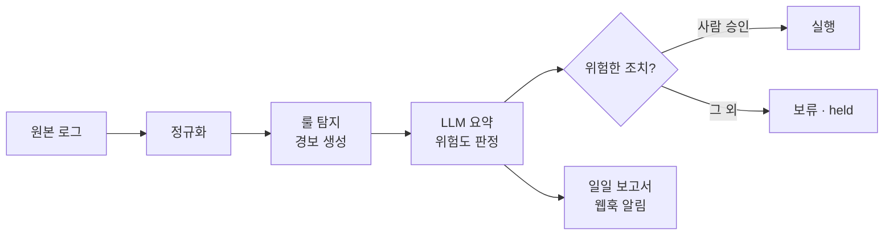

# 🛡️ security-agent-toolkit

SK ALEPH 부트캠프 실습으로 만든 보안 관제 자동화 에이전트와, 함께 공부한 네트워크 · 접근통제 · 이상탐지 실습을 모은 저장소입니다.

> 핵심 원칙: **LLM은 고르기만 하고, 실행은 코드가 하고, 되돌리기 어려운 결정은 사람이 합니다.**

## ⭐ 메인 프로젝트: agent_core_1

로그를 모아 정규화하고, 룰로 경보를 만들고, LLM이 요약 · 위험도를 판정한 뒤, 위험한 조치는 사람 승인을 거쳐 실행하고 보고서와 알림을 보냅니다.

실행 방법, 정한 규칙, 출력 예시, 제공받은 부분과 직접 한 부분은 **[agent_core_1 README](agent_core_1/README.md)**에 있습니다.

## 📂 과목별 실습

폴더 이름 끝의 숫자는 과목 순서입니다.

| 폴더 | 내용 | 자세히 |
|---|---|---|
| `agent_core_1/` | 보안 관제 자동화 파이프라인 (메인 프로젝트) | [README](agent_core_1/README.md) |
| `network_zt_2/` | 패킷 분석 · 서브넷 · DNS · VPN · 방화벽에서 제로트러스트 정책 로그 판정까지 8일 | [README](network_zt_2/README.md) |
| `access_control_3/` | 역할 기반 권한 판정, 예외 권한, 권한 회수, 주간 보고서 | [README](access_control_3/README.md) |
| `anomaly_detection_4/` | 로그 3종류 정규화, 지난 7일 기준으로 로그인 실패 · 트래픽 급증 탐지와 알림 (진행 중) | [README](anomaly_detection_4/README.md) |
| `docs/` | 날짜별 정리 노트와 회고 | [폴더](docs/) |
