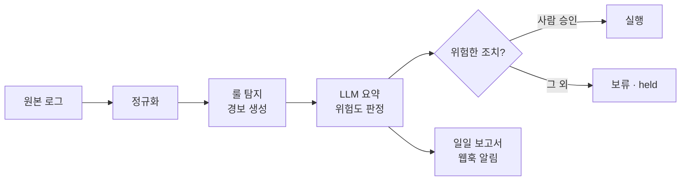
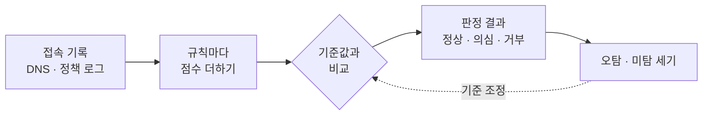
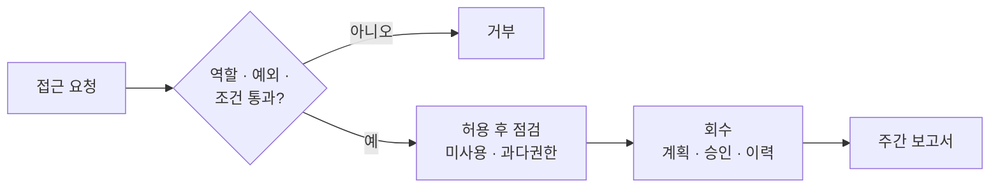
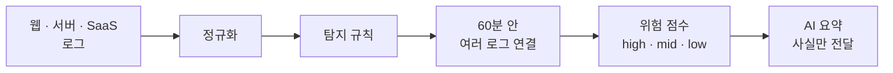
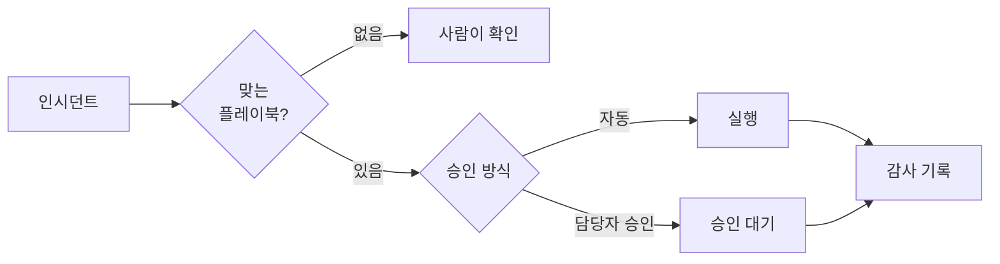

# 🛡️ security-agent-toolkit


SK ALEPH 부트캠프 과목별 실습(보안 관제 자동화 · 네트워크 · 접근통제 · 이상탐지 · 자동 대응)을 모은 저장소입니다.

> 핵심 원칙: **LLM은 고르기만 하고, 실행은 코드가 하고, 되돌리기 어려운 결정은 사람이 합니다.**

## 1과목: 보안 관제 자동화

보안 관제 한 사이클을 파이썬으로 이었습니다. 숫자 같은 사실은 코드가 세고, LLM은 요약과 위험도만 판단합니다. 계정 잠금처럼 되돌리기 어려운 조치는 사람이 승인해야 실행되고, 승인이 없으면 `held`로 남습니다.



```console
$ python pipeline.py
[보고서] daily_report_20261008.md 저장 · 사람 확인 필요 1건
```

**결과:** 단위 테스트 9건 통과. 위 출력은 README에 남긴 실행 예시입니다(실행에 Gemini API 키 필요).

실행 방법, 정한 규칙, 제공받은 부분과 직접 한 부분 → [agent_core_1 README](agent_core_1/README.md)

## 2과목: 네트워크 · 제로트러스트

패킷 · 서브넷 · DNS · VPN · 방화벽을 배운 뒤, 접속 기록을 판정하는 코드를 짰습니다. 판정 코드는 모두 같은 구조입니다. 규칙에 걸릴 때마다 점수를 더하고 기준값과 비교합니다. 기준을 바꿔 가며 정상을 막은 수(오탐)와 위험을 놓친 수(미탐)를 세어 비교했습니다.



**결과:** 직접 짠 방화벽 규칙이 시험 접속 10건을 모두 맞게 판정. 판정 결과와 실제 집행을 대조해 집행 누락 2건 · 과집행 1건 · 우회 1건 발견. 규칙 튜닝에서 기준 A로 바꾸면 오탐 6 → 0, 대신 미탐 1.

일차별 내용과 판정 규칙 → [network_zt_2 README](network_zt_2/README.md)

## 3과목: 접근통제

권한을 주는 것부터 거두는 것까지 한 주기를 만들었습니다. 요청은 역할 권한, 만료 전 예외 순서로 확인하고, 허용이어도 업무 시간 · 접속 위치 조건에 어긋나면 거부합니다. 안 쓰는 권한은 바로 지우지 않고 계획과 승인을 거쳐 회수한 뒤 이력을 남깁니다.



**결과:** 시험 요청 8건을 허용 3 · 거부 5로 판정하고 거부 이유(업무 시간 밖 · 허용되지 않은 접속 위치 · 퇴사한 계정)를 구분. 정책 테스트 4개 통과. 주간 보고서에서 거부율 40%로 경고 기준(30%) 초과, 퇴사자 계정 1건 발견.

판정 순서, 회수 흐름, 일차별 내용 → [access_control_3 README](access_control_3/README.md)

## 4과목: 이상탐지

형식이 다른 로그 세 종류를 같은 칸으로 맞추고, 권한 · SaaS 사용 · 경로 스캔 같은 규칙에 걸린 대상을 시간으로 연결해 위험 점수를 매깁니다. 점수 파일의 사실만 AI에 보내 대상별로 요약하고, 점수와 요약은 먼저 볼 순서일 뿐 공격으로 확정하지 않습니다. 알림을 실제 문제 목록과 맞춰 오탐 · 미탐을 세고 규칙을 조정하는 연습도 했습니다.



**결과:** 이벤트 57개에서 탐지 규칙 8건, 대상 5개를 high 1 · mid 3 · low 1로 분류. 규칙 조정으로 알림 7개 · 오탐 4 · 미탐 2를 알림 6개 · 오탐 2 · 미탐 1로 줄임. AI 요약은 호출 없이(`--offline`) 대체 문장으로만 확인.

탐지 기준, 점수표, 한계 → [anomaly_detection_4 README](anomaly_detection_4/README.md)

## 5과목: 자동 대응(SOAR) (진행 중)

4과목에서 점수를 매긴 대상을 인시던트로 받아, 등록한 플레이북에 맞는 조치를 실행하고 감사 기록을 남깁니다. 퇴사한 계정 잠금처럼 영향이 없는 조치만 자동으로 하고, IP 차단처럼 정상 사용자도 막힐 수 있는 조치는 담당자 승인을 기다립니다.



**결과:** 인시던트 5건 중 자동 실행 1건(계정 잠금 · 티켓), 승인 대기 2건, 맞는 플레이북 없음 2건. 감사 기록 4건 저장.

플레이북 3개와 상태 전이 규칙 → [soar_response_5 README](soar_response_5/README.md)

---

날짜별 정리 노트와 회고는 [docs/](docs/)에 있습니다.
