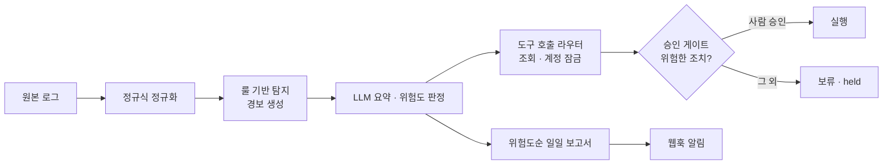
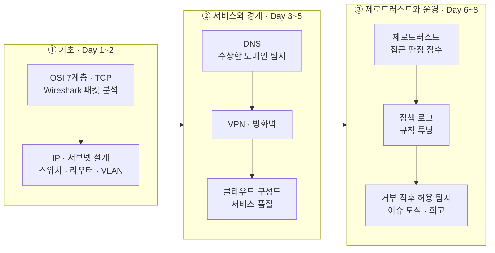
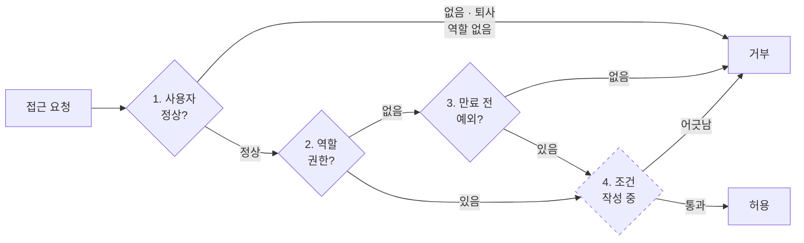
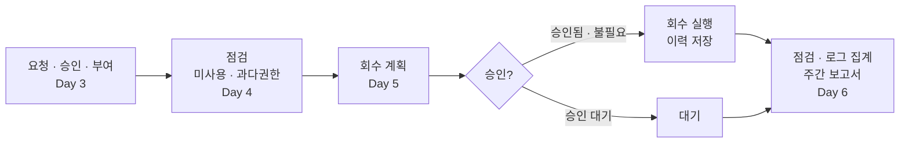

# 🛡️ security-agent-toolkit


**교육과정 실습으로 만든 보안 관제 자동화 에이전트와, 함께 공부한 네트워크 · 접근통제 · 이상탐지 실습을 모은 저장소입니다.**

> 핵심 원칙: **LLM은 고르기만 하고, 실행은 코드가 하고, 되돌리기 어려운 결정은 사람이 합니다.**

---

## 📂 구성

폴더 이름 끝의 숫자는 과목 순서입니다.

| 폴더 | 과목 | 내용 | 바로 가기 |
|---|---|---|---|
| `agent_core_1/` | 1과목 | 메인 프로젝트. 로그 수집부터 보고서 · 알림까지 이어지는 보안 관제 자동화 파이프라인 | [자세히 보기](agent_core_1/README.md) |
| `network_zt_2/` | 2과목 | 네트워크 기초부터 제로트러스트 · 이슈 판정까지 일차별 학습 기록과 실습 코드 | [목차](#-network_zt_2--네트워크--제로트러스트) |
| `access_control_3/` | 3과목 | 역할 기반 접근통제(RBAC) → 예외 · 회수 · 조건기반 정책 → 주간 보고서 | [목차](#-access_control_3--접근통제) |
| `anomaly_detection_4/` | 4과목 | 접속 로그 읽기 · 이상 징후 가르기 · SIEM (진행 중) | [목차](#-anomaly_detection_4--이상탐지) |
| `docs/` | — | 날짜별 정리 노트와 회고 | [폴더](docs/) |

---

## ⭐ agent_core_1 — 보안 관제 자동화 에이전트

로그 수집 → 정규화 → 룰 탐지 → LLM 요약 · 판단 → 도구 실행 → 사람 승인 → 보고서 · 알림까지, 보안 관제의 한 사이클을 파이썬으로 구현한 과정 실습입니다. (제공받은 부분과 직접 한 부분은 [agent_core_1/README.md](agent_core_1/README.md)에 구분해 적었습니다.)



### 만들면서 정한 규칙

| 대상 | 정한 규칙 |
|---|---|
| 로그인 실패 횟수 · IP 정보 | 코드가 직접 세거나 조회한 값만 씁니다. LLM이 내놓은 숫자는 쓰지 않습니다 |
| LLM 응답 | JSON 형식이 아니면 버리고 다음 단계로 넘어갑니다. 목록에 없는 도구 이름은 실행하지 않습니다 |
| 계정 잠금 | 담당자가 승인해야 실행되고, 승인하지 않으면 `held`로 남습니다 |
| 처음 보는 위험도 값 | high로 보고 사람에게 확인을 받습니다 |
| 알림 전송 실패 | 보고서는 그대로 저장하고, 실패 메시지는 출력합니다 |
| API 키 | `.env`에만 두고 저장소에는 올리지 않습니다 |

### 빠른 시작

```bash
git clone https://github.com/mdkk0220/security-agent-toolkit.git
cd security-agent-toolkit/agent_core_1
pip install requests flask
```

`agent_core_1/.env` 파일에 Gemini API 키를 넣습니다. (커밋하지 않습니다)
```
GEMINI_API_KEY=발급받은_키
```

```bash
python alert_server.py      # 터미널 1: 알림을 받는 웹훅 서버
python pipeline.py          # 터미널 2: 보고서 생성 + 알림 전송
python test_agent_core.py   # 단위 테스트
```

설정, 출력 예시, 모듈 구조, 개발 과정은 **[agent_core_1/README.md](agent_core_1/README.md)**에 있습니다.

---

## 🌐 network_zt_2 — 네트워크 · 제로트러스트

8일 동안 패킷 분석부터 제로트러스트 정책 로그 판정까지 배운 내용과 실습 코드입니다.

### 배운 순서



### 일차별로 한 것

| 일차 | 한 것 | 주요 파일 |
|---|---|---|
| Day 1 (10/12) | OSI 7계층과 TCP 연결 과정을 배우고, Wireshark로 패킷을 잡아 분석 보고서를 썼습니다. | `day01_packet_analysis.md` |
| Day 2 (10/13) | IP 주소와 서브넷 나누는 법, 스위치 · 라우터 · VLAN을 배우고 서브넷 설계서를 썼습니다. | `day02_subnet_design.md` |
| Day 3 | DNS가 이름을 IP로 바꾸는 과정을 보고, 수상한 도메인을 점수로 가리는 코드를 짰습니다. 이름이 10글자 이상이면 +1, TLD가 top · xyz · tk면 +1, 없는 도메인(NXDOMAIN)이면 +2를 주고 3점 이상을 의심으로 봅니다. | `day03_pm_dns_suspicious.md`<br/>`day03_7-1_judge_new.py` |
| Day 4 | VPN 터널 · 암호화와 접속 로그를 보고, 방화벽 규칙의 순서와 허용 목록을 배워 방화벽 규칙서를 썼습니다. | `day04_am_vpn.md`<br/>`day04_pm_firewall.md` |
| Day 5 | 클라우드 망 구성도를 읽고 그렸고, 지연 · 지터 · 손실과 tracert로 네트워크 품질을 진단했습니다. | `day05_am_cloud_diagram.md`<br/>`day05_pm_quality.md` |
| Day 6 | A사 제로트러스트 적용 방안을 썼습니다. 직원 12명 데이터로 MFA · 기기 점검 · 최소권한 · 세그멘테이션 · 위험 기반 인증을 항목당 20점씩 매겨 100점 만점 점수를 계산했습니다. 오후에는 Docker 기초를 배웠습니다. | `day06_zt_scenario.md`<br/>`day06_4-1_zt_score.py` |
| Day 7 | 정책 로그를 읽고, 해외 접속 · 대량 조회 점수 기준을 네 가지로 바꿔 가며 정상 요청을 막는 경우(오탐)와 위험 요청을 놓치는 경우(미탐)를 세어 비교했습니다. 정산 포털 로그 점검 결과를 고객용 보고서로 정리했고, 오후에는 Docker Compose를 배웠습니다. | `day07_4-1_rule_tuning.py`<br/>`day07_customer_report.md` |
| Day 8 (10/21) | 같은 계정이 거부된 뒤 10분 안에 허용된 접속을 찾는 코드를 짰습니다. 이상한 페이지가 열리는 이슈를 증상 → 진단 → 원인 가설 순서로 도식으로 그리고, 2과목 회고를 썼습니다. | `day08_3-1_deny_then_allow.py`<br/>`day08_issue_diagram.md`<br/>`day08_retrospective.md` |

`warmup_*.py` · `ping_check.py` · `addr_kind.py`는 수업 시작 전 몸풀기 코드입니다.

---

## 🔐 access_control_3 — 접근통제

A사 계정 · 자원을 예로 들어 권한 판정, 회수, 주간 보고까지 만들었습니다. 앞 단계 파일은 고치지 않고 새 파일로 쌓아 갔고, 사용자 · 권한 데이터는 모두 실습용 가상 데이터입니다.

### 일차별로 한 것

| 일차 | 한 것 | 주요 파일 |
|---|---|---|
| Day 1 (10/21) | 사용자 · 역할 · 권한 파일을 만들고, 역할(RBAC)로 허용 · 거부를 정하는 판정 함수를 짰습니다. 지난 접속 기록을 이 함수로 다시 판정해 한 번도 안 쓰인 권한을 찾았습니다. | `rbac.py`<br/>`day01_7-1_audit.py` |
| Day 2 (10/22) | 입사 · 부서 이동 · 퇴사에 맞춰 역할을 주고 빼는 함수, 정해진 시각까지만 허용하는 예외 권한, 둘을 합친 최종 판정을 만들었습니다. 설정 파일이 없거나 깨져도 멈추지 않고 거부로 동작하게 했고, 테스트 케이스를 설계했습니다. | `policy.py`<br/>`exception_policy.py`<br/>`config_loader.py` |
| Day 3 (10/23) | 권한 요청서를 받아 승인 · 반려하고, 승인된 요청도 정책으로 한 번 더 확인한 뒤 예외 권한을 부여했습니다. | `day03_am_request.md` |
| Day 4 (10/29) | 누가 어떤 권한을 갖고 있는지 현황을 만들고, 퇴사 · 만료 규칙과 사용 이력으로 필요 없어진 권한을 찾아 과다권한 리포트로 묶었습니다. 평소 안 써도 되는 권한은 회수 제외로 뺐습니다. | `review_list.py`<br/>`overprivilege.py`<br/>`report_exclude.py` |
| Day 5 (10/30) | 회수 대상마다 회수 계획을 세우고, 민감한 권한은 승인된 것만 실행해 이력을 남겼습니다. 오후에는 업무 시간 · 접속 위치 조건(작성 중)과 판정 서버를 만들었습니다. | `revoke_plan.py`<br/>`revoke.py`<br/>`conditional.py`<br/>`access_server.py` |
| Day 6 (11/2) | 퇴사자 · 만료 예외 · 부서와 역할을 체크리스트로 점검하고, 요청 로그를 집계해 주간 보고서를 만들었습니다. | `checklist.py`<br/>`log_summary.py`<br/>`weekly_report.py` |

### 요청 한 건을 판정하는 순서

`policy.py`가 아래 순서로 확인하고, 하나라도 걸리면 그 자리에서 거부합니다.

1. 사용자 상태: 없는 계정, 퇴사자, 역할이 없는 계정이면 거부
2. 역할 권한: 역할에 그 권한이 있으면 4단계로
3. 예외 권한: 역할에 없더라도 만료 전 예외가 있으면 4단계로, 없으면 거부
4. 조건: 업무 시간 · 접속 위치 확인 (`conditional.py`, 작성 중이라 지금은 3단계까지만 동작)



### 권한을 주고 회수하기까지

회수는 바로 지우지 않습니다. 계획을 세우고, 승인된 것만 실행하고, 이력을 남깁니다.



---

## 📈 anomaly_detection_4 — 이상탐지

| 일차 | 주제 | 주요 파일 |
|---|---|---|
| Day 1 (11/2) | 접속 로그 한 줄을 조각으로 읽기 · 이상 징후 가르기 · SIEM | `day01_pm_log_basics.md` |

---

## 📝 참고

- `*_report.md` 파일(`access_control_3/` 10개, `network_zt_2/` 11개, `anomaly_detection_4/` 1개)은 교시별 리포트입니다. 질문은 수업에서 주어졌고, `답:` 뒤의 내용은 직접 쓴 것입니다.
- 실습 문서 속 이름 · 주소 · 비밀번호 값은 모두 수업용 예시입니다.
- 무료 Gemini 키는 호출 횟수 제한이 있어, `429` 오류가 나면 1분 뒤 다시 실행하세요.
