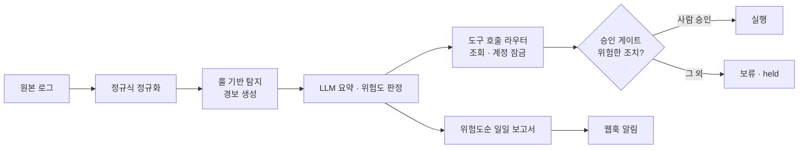

# 🛡️ security-agent-toolkit


**보안 관제 자동화 에이전트와, 그것을 만들기까지 공부한 네트워크 · 접근 제어 실습을 모은 저장소입니다.**

> 핵심 원칙: **LLM은 고르기만 하고, 실행은 코드가 하고, 되돌리기 어려운 결정은 사람이 합니다.**

---

## 📂 구성

| 폴더 | 내용 | 바로 가기 |
|---|---|---|
| **`agent_core/`** | ⭐ 메인 프로젝트. 로그 수집부터 보고서 · 알림까지 이어지는 보안 관제 자동화 파이프라인 | [자세히 보기](agent_core/README.md) |
| `network_zt/` | 네트워크 기초부터 제로트러스트까지 일별 학습 기록과 실습 코드 | [목차](#-network_zt--네트워크--제로트러스트-학습) |
| `access_control/` | 역할 기반 접근 제어(RBAC)와 접근 로그 감사 실습 | [폴더](access_control/config) |
| `docs/` | 날짜별 정리 노트와 회고 | [폴더](docs/docs) |

---

## ⭐ agent_core — 보안 관제 자동화 에이전트

로그 수집 → 정규화 → 룰 탐지 → LLM 요약 · 판단 → 도구 실행 → 사람 승인 → 보고서 · 알림까지, 보안 관제의 한 사이클을 파이썬으로 구현했습니다.



### 설계에서 신경 쓴 점

| 원칙 | 구현 |
|---|---|
| **사실은 코드가 확인한다** | 로그인 실패 횟수, IP 정보 같은 사실은 도구와 코드가 세고, LLM이 지어낸 값은 쓰지 않습니다 |
| **LLM의 답을 검증한다** | JSON이 아닌 답은 버리고 계속 진행합니다. 목록에 없는 도구 이름은 실행하지 않습니다 |
| **위험한 조치는 사람이 승인한다** | 계정 잠금은 담당자가 승인할 때만 실행하고, 아니면 `held`로 기록합니다 |
| **모르면 막는 쪽으로** | 처음 보는 위험도 값은 high로 보고 사람에게 묻습니다 |
| **일부가 실패해도 전체는 계속된다** | 알림 전송이 실패해도 보고서는 저장되고, 실패는 숨기지 않고 출력합니다 |
| **비밀은 코드에 두지 않는다** | API 키는 `.env`에만 두고 저장소에 올리지 않습니다 |

### 빠른 시작

```bash
git clone https://github.com/mdkk0220/security-agent-toolkit.git
cd security-agent-toolkit/agent_core
pip install requests flask
```

`agent_core/.env` 파일에 Gemini API 키를 넣습니다. (커밋하지 않습니다)
```
GEMINI_API_KEY=발급받은_키
```

```bash
python alert_server.py      # 터미널 1: 알림을 받는 웹훅 서버
python pipeline.py          # 터미널 2: 보고서 생성 + 알림 전송
python test_agent_core.py   # 단위 테스트
```

설정, 출력 예시, 모듈 구조, 개발 과정은 **[agent_core/README.md](agent_core/README.md)**에 있습니다.

---

## 🌐 network_zt — 네트워크 · 제로트러스트 학습

| 주제 | 주요 자료 |
|---|---|
| OSI 7계층 · TCP와 Wireshark 패킷 분석 | `day01_packet_analysis.md`, `261012_am_osi_layers.md`, `261012_pm_tcp_wireshark.md` |
| IP · 서브넷 설계 · 스위치 · 라우터 · VLAN | `day02_subnet_design.md`, `261013_am_ip_subnet.md`, `261013_pm_switch_router_vlan.md` |
| DNS · 수상한 도메인(DGA) 탐지 | `day03_am_dns.md`, `day03_pm_dns_suspicious.md`, `day03_*.py` |
| VPN · 방화벽 | `day04_am_vpn.md`, `day04_pm_firewall.md` |
| 클라우드 구성도 · 서비스 품질 | `day05_am_cloud_diagram.md`, `day05_pm_quality.md` |
| 제로트러스트 · 접근 판정 점수 · Docker 기초 | `day06_am_zero_trust.md`, `day06_4-1_zt_score.py`, `day06_pm_docker_basics.md` |
| 정책 로그 · 규칙 튜닝 · Docker Compose | `day07_am_policy_log.md`, `day07_4-1_rule_tuning.py`, `day07_docker/` |
| 장애 원인 지도 · 회고 | `day08_am_issue_map.md`, `day08_retrospective.md` |

---

## 🔐 access_control — 접근 제어 실습

- `rbac.py`, `roles.json`, `users.json`: 역할별 권한을 정의하고 사용자의 요청을 허용 · 거부 판정
- `access_log.py`, `day01_7-1_audit.py`: 접근 기록을 남기고 감사
- 사용자 데이터는 실습용 가상 데이터입니다

---

## 📝 참고

- 무료 Gemini 키는 호출 횟수 제한이 있어, `429` 오류가 나면 1분 뒤 다시 실행하세요.
