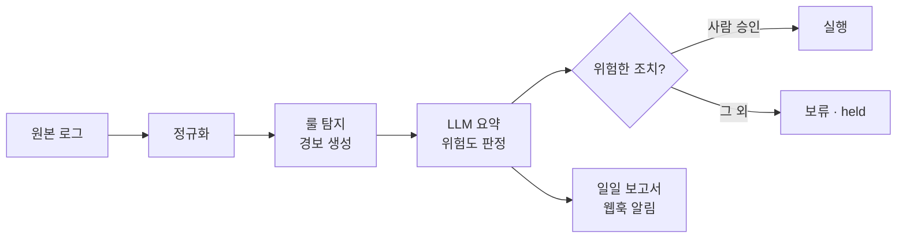
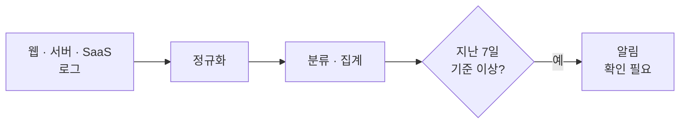

# 🛡️ security-agent-toolkit

SK ALEPH 부트캠프 실습으로 만든 보안 관제 자동화 에이전트와, 함께 공부한 네트워크 · 접근통제 · 이상탐지 실습을 모은 저장소입니다.

> 핵심 원칙: **LLM은 고르기만 하고, 실행은 코드가 하고, 되돌리기 어려운 결정은 사람이 합니다.**

## ⭐ 1과목: agent_core_1 (메인 프로젝트)

로그를 모아 정규화하고, 룰로 경보를 만들고, LLM이 요약 · 위험도를 판정한 뒤, 위험한 조치는 사람 승인을 거쳐 실행하고 보고서와 알림을 보냅니다.

실행 방법, 정한 규칙, 출력 예시, 제공받은 부분과 직접 한 부분은 [agent_core_1 README](agent_core_1/README.md)에 있습니다.

## 🌐 2과목: network_zt_2

패킷 분석과 서브넷 설계부터 DNS · VPN · 방화벽을 거쳐, 제로트러스트 정책 로그를 점수로 판정하는 코드까지 8일 동안 배웠습니다.

일차별 내용과 판정 규칙은 [network_zt_2 README](network_zt_2/README.md)에 있습니다.

## 🔐 3과목: access_control_3

A사 계정을 예로 들어 역할로 권한을 판정하고, 쓰지 않는 권한을 찾아 승인을 거쳐 회수한 뒤 주간 보고서로 정리했습니다.

판정 순서와 회수 흐름은 [access_control_3 README](access_control_3/README.md)에 있습니다.

## 📈 4과목: anomaly_detection_4 (진행 중)

로그 세 종류를 한 형식으로 맞추고, 지난 7일 기록으로 정한 기준을 넘는 로그인 실패와 트래픽 급증을 찾아 알림으로 남깁니다.

탐지 기준과 한계는 [anomaly_detection_4 README](anomaly_detection_4/README.md)에 있습니다.

---

폴더 이름 끝의 숫자는 과목 순서입니다. 날짜별 정리 노트와 회고는 [docs/](docs/)에 있습니다.
