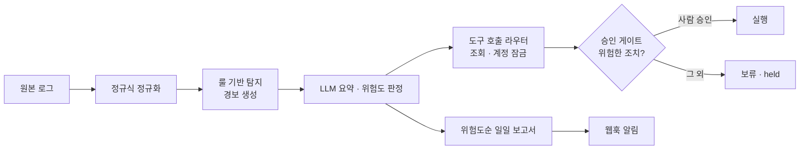
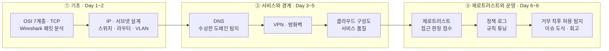
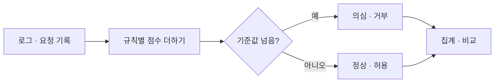
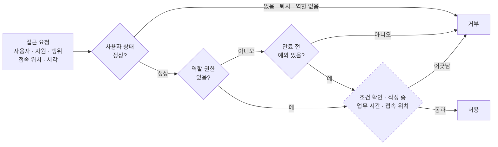
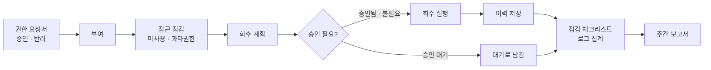

# 🛡️ security-agent-toolkit


**교육과정 실습으로 만든 보안 관제 자동화 에이전트와, 함께 공부한 네트워크 · 접근통제 · 이상탐지 실습을 모은 저장소입니다.**

> 핵심 원칙: **LLM은 고르기만 하고, 실행은 코드가 하고, 되돌리기 어려운 결정은 사람이 합니다.**

---

## 📂 구성

폴더 이름 끝의 숫자는 과목 순서입니다.

| 폴더 | 과목 | 내용 | 바로 가기 |
|---|---|---|---|
| `agent_core_1/` | 1과목 | 메인 프로젝트. 로그 수집부터 보고서 · 알림까지 이어지는 보안 관제 자동화 파이프라인 | [자세히 보기](agent_core_1/README.md) |
| `network_zt_2/` | 2과목 | 네트워크 기초부터 제로트러스트 · 이슈 판정까지 일차별 학습 기록과 실습 코드 | [목차](#-network_zt_2--네트워크--제로트러스트) |
| `access_control_3/` | 3과목 | 역할 기반 접근통제(RBAC) → 예외 · 회수 · 조건기반 정책 → 주간 보고서 | [목차](#-access_control_3--접근통제) |
| `anomaly_detection_4/` | 4과목 | 접속 로그 읽기 · 이상 징후 가르기 · SIEM (진행 중) | [목차](#-anomaly_detection_4--이상탐지) |
| `docs/` | — | 날짜별 정리 노트와 회고 | [폴더](docs/) |

---

## ⭐ agent_core_1 — 보안 관제 자동화 에이전트

로그 수집 → 정규화 → 룰 탐지 → LLM 요약 · 판단 → 도구 실행 → 사람 승인 → 보고서 · 알림까지, 보안 관제의 한 사이클을 파이썬으로 구현한 과정 실습입니다. (제공받은 부분과 직접 한 부분은 [agent_core_1/README.md](agent_core_1/README.md)에 구분해 적었습니다.)



### 만들면서 정한 규칙

| 대상 | 정한 규칙 |
|---|---|
| 로그인 실패 횟수 · IP 정보 | 코드가 직접 세거나 조회한 값만 씁니다. LLM이 내놓은 숫자는 쓰지 않습니다 |
| LLM 응답 | JSON 형식이 아니면 버리고 다음 단계로 넘어갑니다. 목록에 없는 도구 이름은 실행하지 않습니다 |
| 계정 잠금 | 담당자가 승인해야 실행되고, 승인하지 않으면 `held`로 남습니다 |
| 처음 보는 위험도 값 | high로 보고 사람에게 확인을 받습니다 |
| 알림 전송 실패 | 보고서는 그대로 저장하고, 실패 메시지는 출력합니다 |
| API 키 | `.env`에만 두고 저장소에는 올리지 않습니다 |

### 빠른 시작

```bash
git clone https://github.com/mdkk0220/security-agent-toolkit.git
cd security-agent-toolkit/agent_core_1
pip install requests flask
```

`agent_core_1/.env` 파일에 Gemini API 키를 넣습니다. (커밋하지 않습니다)
```
GEMINI_API_KEY=발급받은_키
```

```bash
python alert_server.py      # 터미널 1: 알림을 받는 웹훅 서버
python pipeline.py          # 터미널 2: 보고서 생성 + 알림 전송
python test_agent_core.py   # 단위 테스트
```

설정, 출력 예시, 모듈 구조, 개발 과정은 **[agent_core_1/README.md](agent_core_1/README.md)**에 있습니다.

---

## 🌐 network_zt_2 — 네트워크 · 제로트러스트

패킷 한 개를 읽는 데서 시작해, 제로트러스트 정책을 세우고 그 로그를 판정하는 데까지 8일 동안 순서대로 쌓았습니다.



판정 실습 코드는 모두 로그를 읽고 규칙마다 점수를 더한 다음, 기준값으로 판정하고 결과를 집계하는 흐름입니다.



| 일차 | 입력 | 규칙 | 결과 |
|---|---|---|---|
| Day 3 DNS | 도메인 이름 · 응답 코드 | 이름 10글자 이상 +1, TLD가 top · xyz · tk +1, NXDOMAIN +2 | 3점 이상이면 의심 |
| Day 6 제로트러스트 | 직원별 MFA · 기기 점검 · 초과 권한 | MFA · 기기 · 최소권한 · 세그멘테이션 · 위험 기반 인증 각 20점 | 회사 성숙도 총점 /100 |
| Day 7 규칙 튜닝 | 한 주 요청 기록 | 해외 접속 +30, 대량 조회 기준 이상 +점수 | 기준안 4개(현재 · A · B · C)별 오탐 · 미탐 수 비교 |
| Day 8 이슈 탐지 | 정책 로그(JSON) | 같은 계정이 거부 후 10분 안에 허용 | 거부 직후 허용 목록 · 거부 사유별 건수 |

| 일차 | 주제 | 주요 파일 |
|---|---|---|
| Day 1 (10/12) | OSI 7계층 · TCP와 Wireshark 패킷 분석 | `day01_packet_analysis.md` · `261012_am_osi_layers.md` · `261012_pm_tcp_wireshark.md` |
| Day 2 (10/13) | IP · 서브넷 설계 · 스위치 · 라우터 · VLAN | `day02_subnet_design.md` · `261013_am_ip_subnet.md` · `261013_pm_switch_router_vlan.md` |
| Day 3 | DNS · 수상한 도메인(DGA) 탐지 | `day03_am_dns.md` · `day03_pm_dns_suspicious.md` · `day03_*.py` |
| Day 4 | VPN · 방화벽 | `day04_am_vpn.md` · `day04_pm_firewall.md` |
| Day 5 | 클라우드 구성도 · 서비스 품질 | `day05_am_cloud_diagram.md` · `day05_pm_quality.md` |
| Day 6 | 제로트러스트 · 접근 판정 점수 · Docker 기초 | `day06_am_zero_trust.md` · `day06_4-1_zt_score.py` · `day06_zt_scenario.md` · `day06_pm_docker_basics.md` |
| Day 7 | 정책 로그 · 규칙 튜닝 · Docker Compose | `day07_am_policy_log.md` · `day07_4-1_rule_tuning.py` · `day07_customer_report.md` · `day07_docker/` |
| Day 8 (10/21) | 서버 알림 판정 · 거부 직후 허용 탐지 · 이슈 도식 · 회고 | `day08_am_issue_map.md` · `day08_3-1_deny_then_allow.py` · `day08_issue_diagram.md` · `day08_retrospective.md` |

`warmup_*.py` · `ping_check.py` · `addr_kind.py`는 수업 시작 전 몸풀기 코드입니다.

---

## 🔐 access_control_3 — 접근통제

A사 계정 · 자원을 예로, 권한 판정부터 회수 · 주간 보고까지 접근통제의 한 주기를 단계별로 만들었습니다. 앞 단계 파일은 고치지 않고 새 파일로 쌓아 갔습니다.

| 일차 | 주제 | 주요 파일 |
|---|---|---|
| Day 1 (10/21) | 인증과 인가 · RBAC 권한 판정 · 기록으로 권한 점검 | `rbac.py` · `access_log.py` · `day01_7-1_audit.py` · `config/users.json` · `config/roles.json` |
| Day 2 (10/22) | 역할 부여 · 회수 · 기간이 정해진 예외 권한 · 설정이 고장 나도 거부 · 테스트 케이스 | `policy.py` · `exception_policy.py` · `config_loader.py` · `config/exceptions.json` · `day02_pm_tests.md` |
| Day 3 (10/23) | 권한 요청서 · 승인과 반려 · 정책 확인 후 부여 | `day03_am_request.md` |
| Day 4 (10/29) | 접근 점검 · 필요 없어진 권한 찾기 · 과다권한 리포트 · 회수 제외 | `review_list.py` · `review_rules.py` · `review_unused.py` · `overprivilege.py` · `report_exclude.py` |
| Day 5 (10/30) | 권한 회수 계획 · 승인 · 실행 · 이력 · 조건기반 정책 · 판정 서버 | `revoke_plan.py` · `revoke_approve.py` · `revoke.py` · `conditional.py` · `access_server.py` |
| Day 6 (11/2) | 점검 체크리스트 · 로그 집계 · 주간 보고서 | `checklist.py` · `log_summary.py` · `weekly_report.py` · `access_control_weekly_report_2026-11-02.md` |

요청 한 건을 판정하는 순서 (`policy.py`, `conditional.py`)



> 점선으로 표시한 조건 확인(업무 시간 · 접속 위치)은 `conditional.py`에서 아직 작성 중입니다. 지금 코드는 역할 · 예외 판정까지만 동작합니다.

권한을 주고 회수하고 보고하기까지 (Day 3~6)



판정은 역할 권한, 유효한 예외 순으로 보고 둘 다 없으면 거부합니다. 설정 파일이 없거나 깨져 있을 때도 경고를 내고 거부로 동작하게 했습니다. 권한 회수는 바로 지우지 않고 계획, 승인, 실행, 이력 저장 순서로 진행합니다.

사용자 · 권한 데이터는 모두 실습용 가상 데이터입니다.

---

## 📈 anomaly_detection_4 — 이상탐지

| 일차 | 주제 | 주요 파일 |
|---|---|---|
| Day 1 (11/2) | 접속 로그 한 줄을 조각으로 읽기 · 이상 징후 가르기 · SIEM | `day01_pm_log_basics.md` |

---

## 📝 참고

- `*_report.md` 파일(`access_control_3/` 10개, `network_zt_2/` 11개, `anomaly_detection_4/` 1개)은 교시별 리포트입니다. 질문은 수업에서 주어졌고, `답:` 뒤의 내용은 직접 쓴 것입니다.
- 실습 문서 속 이름 · 주소 · 비밀번호 값은 모두 수업용 예시입니다.
- 무료 Gemini 키는 호출 횟수 제한이 있어, `429` 오류가 나면 1분 뒤 다시 실행하세요.
