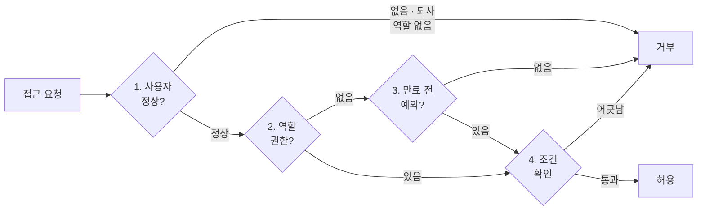
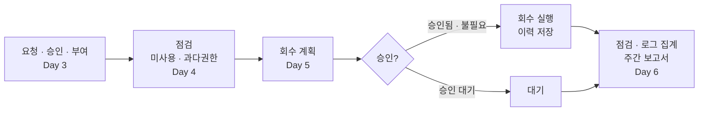

# 🔐 access_control_3 — 접근통제

SK ALEPH 부트캠프 3과목 (10/21 ~ 11/2). A사 계정 · 자원을 예로 들어 권한 판정, 회수, 주간 보고까지 만들었습니다. 앞 단계 파일은 고치지 않고 새 파일로 쌓아 갔고, 사용자 · 권한 데이터는 모두 실습용 가상 데이터입니다.

## 일차별로 한 것

| 일차 | 한 것 | 주요 파일 |
|---|---|---|
| Day&nbsp;1&nbsp;(10/21) | 사용자 · 역할 · 권한 파일을 만들고, 역할(RBAC)로 허용 · 거부를 정하는 판정 함수를 짰습니다. 지난 접속 기록을 이 함수로 다시 판정해 한 번도 안 쓰인 권한을 찾았습니다. | `rbac.py` `day01_7-1_audit.py` |
| Day&nbsp;2&nbsp;(10/22) | 입사 · 부서 이동 · 퇴사에 맞춰 역할을 주고 빼는 함수, 정해진 시각까지만 허용하는 예외 권한, 둘을 합친 최종 판정을 만들었습니다. 설정 파일이 없거나 깨져도 멈추지 않고 거부로 동작하게 했고, 테스트 케이스를 설계했습니다. | `policy.py` `exception_policy.py` `config_loader.py` |
| Day&nbsp;3&nbsp;(10/23) | 권한 요청서를 받아 승인 · 반려하고, 승인된 요청도 정책으로 한 번 더 확인한 뒤 예외 권한을 부여했습니다. | `day03_am_request.md` |
| Day&nbsp;4&nbsp;(10/29) | 누가 어떤 권한을 갖고 있는지 현황을 만들고, 퇴사 · 만료 규칙과 사용 이력으로 필요 없어진 권한을 찾아 과다권한 리포트로 묶었습니다. 평소 안 써도 되는 권한은 회수 제외로 뺐습니다. | `review_list.py` `overprivilege.py` `report_exclude.py` |
| Day&nbsp;5&nbsp;(10/30) | 회수 대상마다 회수 계획을 세우고, 민감한 권한은 승인된 것만 실행해 이력을 남겼습니다. 오후에는 업무 시간 · 접속 위치 조건과 판정 서버를 만들었습니다. | `revoke_plan.py` `revoke.py` `conditional.py` `access_server.py` |
| Day&nbsp;6&nbsp;(11/2) | 퇴사자 · 만료 예외 · 부서와 역할을 체크리스트로 점검하고, 요청 로그를 집계해 주간 보고서를 만들었습니다. | `checklist.py` `log_summary.py` `weekly_report.py` |

## 요청 한 건을 판정하는 순서

`policy.py`가 아래 순서로 확인하고, 하나라도 걸리면 그 자리에서 거부합니다.

1. 사용자 상태: 없는 계정, 퇴사자, 역할이 없는 계정이면 거부
2. 역할 권한: 역할에 그 권한이 있으면 4단계로
3. 예외 권한: 역할에 없더라도 만료 전 예외가 있으면 4단계로, 없으면 거부
4. 조건: 업무 시간 · 접속 위치 확인 (`conditional.py`)

## 권한을 주고 회수하기까지

회수는 바로 지우지 않습니다. 계획을 세우고, 승인된 것만 실행하고, 이력을 남깁니다.

## 참고

- `*_report.md` 파일(10개)은 교시별 리포트입니다. 질문은 수업에서 주어졌고, `답:` 뒤의 내용은 직접 쓴 것입니다.
- 실습 문서 속 이름 · 주소 · 비밀번호 값은 모두 수업용 예시입니다.

[← 저장소 처음으로](../Readme.md)
