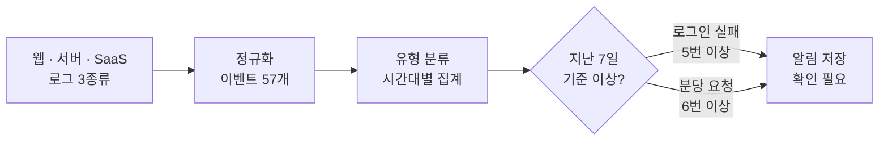

# 📈 anomaly_detection_4 — 이상탐지

SK ALEPH 부트캠프 4과목 (11/2 ~ , 진행 중). 서로 다른 로그 세 종류를 한 형식으로 맞추고, 지난 7일 기록으로 기준값을 정해 평소와 다른 로그인 실패와 트래픽 급증을 찾아 알림으로 남깁니다.

## 흐름



## 일차별로 한 것

| 일차 | 한 것 | 주요 파일 |
|---|---|---|
| Day&nbsp;1&nbsp;(11/2) | 웹 접속 로그 한 줄을 IP · 요청 · 상태 코드로 나눠 읽고, 줄마다 정상 · 오류 · 의심을 갈랐습니다. SIEM이 무엇이고 현업에서 어떻게 쓰는지 정리했습니다. | `day01_pm_log_basics.md`<br/>`log_parse.py` |
| Day&nbsp;2&nbsp;(11/3)&nbsp;오전 | 웹 접속 로그(nginx), 판정 서버 로그(JSON), SaaS 로그(CSV)를 시간 · 출처 · 사용자 · IP · 행동 · 결과 칸으로 맞춰 시간순으로 합쳤습니다. 깨진 줄 2개는 건너뛰고 이벤트 57개(웹 28, 서버 15, SaaS 14)를 저장했습니다. | `normalize.py`<br/>`normalize_web.py`<br/>`normalize_json_csv.py` |
| Day&nbsp;2&nbsp;(11/3)&nbsp;오후 | pandas로 정규화한 이벤트를 표로 읽고, 실패 이벤트 23개를 골라 사용자별 · 시간대별로 세어 `failed_events.csv`로 저장했습니다. | `events_basic.py`<br/>`events_time.py` |
| Day&nbsp;3&nbsp;(11/4)&nbsp;오전 | 지난 7일 로그인 실패 기록(하루 최대 4번)으로 기준을 5번 이상으로 정하고, 기준을 넘은 IP(`203.0.113.50`, 5번)를 찾았습니다. 이벤트를 비정상 로그인 5, 비인가 접근 3, 기타 실패 15, 정상 34로 나누는 규칙도 만들었습니다. | `baseline.py`<br/>`login_detection.py`<br/>`classify.py` |
| Day&nbsp;3&nbsp;(11/4)&nbsp;오후 | 웹 요청을 분 단위로 세어 평소 평균(분당 2.0)의 3배인 6번 이상을 급증으로 보고, 09:12의 9개 요청을 찾았습니다. 로그인 실패와 트래픽 급증 결과를 같은 형식의 알림 2건으로 `alerts.json`에 저장했습니다. | `traffic_detection.py`<br/>`alerts.py` |

## 탐지 기준

| 탐지 | 기준 | 근거 |
|---|---|---|
| 로그인&nbsp;실패 | 같은 IP의 `POST /login` 실패 5번 이상 | 지난 7일 하루 최대 4번 + 1 |
| 트래픽&nbsp;급증 | 1분 동안 웹 요청 6번 이상 | 지난 7일 분당 평균 2.0 × 3 |

알림은 모두 "확인 필요" 상태로 남깁니다. 기준을 넘었다고 공격으로 확정하지 않고, 사람이 먼저 살펴볼 곳으로 표시합니다.

## 알아 둘 점

- 요청 수만 세는 규칙은 적은 수의 탐색 요청을 놓칩니다. 09:20에 `/.env`, `/wp-login.php`, `/phpmyadmin`을 찾는 요청 3개는 기준(6번) 아래라 탐지되지 않았습니다.
- 09:12의 로그인 실패와 트래픽 급증은 같은 IP에서 일어난 일이지만 알림이 2건으로 따로 나옵니다.
- 웹 로그의 시간대(`+0900`)를 떼고 합칩니다. 세 로그 모두 한국 시간이라고 보고 처리합니다.

## 실행

```bash
cd anomaly_detection_4
pip install pandas
python day02_4-1_run.py   # 로그 3종류 정규화 → normalized_events.json
python day03_6-1_run.py   # 로그인 실패 · 트래픽 급증 탐지 → alerts.json
```

## 참고

- 실습 문서와 샘플 로그는 수업에서 제공받았습니다.
- `*_report.md` 파일(5개)은 교시별 리포트입니다. 질문은 수업에서 주어졌고, `답:` 뒤의 내용은 직접 푼 결과를 AI 도구로 정리해 적었습니다.
- 실습 문서 속 이름 · 주소 · 비밀번호 값은 모두 수업용 예시입니다.

[← 저장소 처음으로](../Readme.md)
