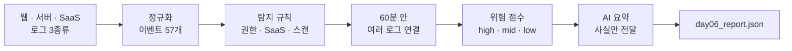

# 📈 anomaly_detection_4 — 이상탐지

SK ALEPH 부트캠프 4과목 (11/2 ~ 11/9). 서로 다른 로그 세 종류를 한 형식으로 맞추고, 탐지 규칙에 걸린 대상을 시간으로 연결해 위험 점수를 매긴 뒤, 점수의 사실만 AI에 보내 요약하는 파이프라인까지 만들었습니다. 오탐 · 미탐을 세어 규칙을 조정하는 연습도 했습니다.

## 흐름



`python pipeline.py --offline` 결과: 이벤트 57개 · 탐지 규칙 8건 · 대상 5건 (AI 호출은 생략하고 대체 문장으로 확인)

## 일차별로 한 것

| 일차 | 한 것 | 주요 파일 |
|---|---|---|
| Day&nbsp;1&nbsp;(11/2) | 웹 접속 로그 한 줄을 IP · 요청 · 상태 코드로 나눠 읽고, 줄마다 정상 · 오류 · 의심을 갈랐습니다. SIEM이 무엇이고 현업에서 어떻게 쓰는지 정리했습니다. | `day01_pm_log_basics.md`<br/>`log_parse.py` |
| Day&nbsp;2&nbsp;(11/3)&nbsp;오전 | 웹 접속 로그(nginx), 판정 서버 로그(JSON), SaaS 로그(CSV)를 시간 · 출처 · 사용자 · IP · 행동 · 결과 칸으로 맞춰 시간순으로 합쳤습니다. 깨진 줄 2개는 건너뛰고 이벤트 57개(웹 28, 서버 15, SaaS 14)를 저장했습니다. | `normalize.py`<br/>`normalize_web.py`<br/>`normalize_json_csv.py` |
| Day&nbsp;2&nbsp;(11/3)&nbsp;오후 | pandas로 정규화한 이벤트를 표로 읽고, 실패 이벤트 23개를 골라 사용자별 · 시간대별로 세어 `failed_events.csv`로 저장했습니다. | `events_basic.py`<br/>`events_time.py` |
| Day&nbsp;3&nbsp;(11/4)&nbsp;오전 | 지난 7일 로그인 실패 기록(하루 최대 4번)으로 기준을 5번 이상으로 정하고, 기준을 넘은 IP(`203.0.113.50`, 5번)를 찾았습니다. 이벤트를 비정상 로그인 5, 비인가 접근 3, 기타 실패 15, 정상 34로 나누는 규칙도 만들었습니다. | `baseline.py`<br/>`login_detection.py`<br/>`classify.py` |
| Day&nbsp;3&nbsp;(11/4)&nbsp;오후 | 웹 요청을 분 단위로 세어 평소 평균(분당 2.0)의 3배인 6번 이상을 급증으로 보고, 09:12의 9개 요청을 찾았습니다. 로그인 실패와 트래픽 급증 결과를 같은 형식의 알림 2건으로 `alerts.json`에 저장했습니다. | `traffic_detection.py`<br/>`alerts.py` |
| Day&nbsp;4&nbsp;(11/5)&nbsp;오전 | 판정 서버가 거절한 요청 9개 중 먼저 볼 7개를 이유로 줄 세우고(퇴사한 계정 4 · 규칙은 허용인데 서버가 거절 3), SaaS에서 업무 시간 밖 로그인 · 평소와 다른 IP · 5번 이상 다운로드를, 웹에서 스캐너 경로를 3번 요청한 IP를 찾았습니다. | `access_detection.py`<br/>`saas_detection.py`<br/>`malicious_detection.py` |
| Day&nbsp;4&nbsp;(11/5)&nbsp;오후 | 사용자별로 세 로그를 시간순으로 이어 60분 안에 서로 다른 로그에서 나온 사건(gaeun, 3종류 · 41분)을 찾고, 이유마다 점수를 더해 대상 5개에 등급을 매겼습니다. | `correlation.py`<br/>`risk_scores.py` |
| Day&nbsp;5&nbsp;(11/6)&nbsp;오전 | 알림 7개를 실제 문제 목록과 맞춰 오탐 4 · 미탐 2를 세고, 믿는 IP 예외 규칙과 로그인 알림 합치기를 적용해 알림 6개 · 오탐 2 · 미탐 1로 줄였습니다. 예외로 빠진 알림 중 진짜 문제는 0개인 것도 확인했습니다. | `evaluation.py`<br/>`tuning.py`<br/>`final_check.py` |
| Day&nbsp;5&nbsp;(11/6)&nbsp;오후 | Docker Compose 파일로 웹 서버 여러 대의 포트를 정하고, 외부에 열 서버와 `127.0.0.1`에만 열 서버를 나눴습니다. Docker를 실행할 수 없는 환경이라 실제 실행은 하지 못했습니다. | `compose.yaml`<br/>`compose.secure.yaml` |
| Day&nbsp;6&nbsp;(11/9)&nbsp;오전 | Day 4의 탐지 · 연결 · 점수를 하나로 묶고, 점수 파일의 사실만 Gemini에 보내 대상별로 요약하는 파이프라인을 만들었습니다. 요약이 실패하면 규칙 이름으로 만든 대체 문장을 씁니다. | `pipeline.py`<br/>`day06_report.json` |

## 탐지 기준과 점수

| 탐지 | 기준 | 점수 |
|---|---|---|
| 로그인&nbsp;실패 | 같은 IP의 `POST /login` 실패 5번 이상 (지난 7일 하루 최대 4번 + 1) | 알림만 |
| 트래픽&nbsp;급증 | 1분 동안 웹 요청 6번 이상 (지난 7일 분당 평균 2.0 × 3) | 알림만 |
| 퇴사한&nbsp;계정 | 퇴사 처리된 계정이 서버에 요청 | 60 |
| 경로&nbsp;스캔 | 스캐너 경로(`/.env` 등) 요청 | 30 |
| 여러&nbsp;로그&nbsp;연결 | 같은 사용자의 기록이 60분 안에 서로 다른 로그 2종류 이상에서 나옴 (서버 · 웹은 실패만, SaaS는 전체) | 30 |
| 대량&nbsp;다운로드 | SaaS 파일 다운로드 5번 이상 | 25 |
| 평소와&nbsp;다른&nbsp;IP | 사용자별 평소 IP가 아닌 곳에서 로그인 | 20 |
| 권한&nbsp;없음 | 역할에 없는 권한 요청 | 20 |
| 업무&nbsp;시간&nbsp;밖 | 업무 시간 밖 로그인 | 15 |
| 허용인데&nbsp;거절 | 권한 규칙은 허용인데 서버가 거절 | 10 |

등급은 60점 이상 high, 35점 이상 mid, 그 아래 low입니다. 결과: dami 60(high), seoyeon 45 · gaeun 40 · jiwoo 35(mid), `198.51.100.90` 30(low). 점수는 먼저 볼 순서일 뿐이고, 알림과 요약은 모두 공격으로 확정하지 않습니다.

## 알아 둘 점

- 요청 수만 세는 규칙은 적은 수의 탐색 요청을 놓칩니다. Day 3에서 놓친 09:20의 스캐너 경로 요청은 Day 4의 경로 스캔 규칙으로 잡았습니다.
- 규칙을 조정한 뒤에도 미탐 1개가 남았습니다 (seoyeon의 권한 없는 정산 조회).
- Day 5 오후 Docker 출력과 `logs/web_404.log`는 실습 안내서의 예시이고 실제 실행 결과가 아닙니다.
- Day 6 파이프라인은 `--offline`으로만 확인했고 Gemini 요약은 실제로 받지 않았습니다.
- `alerts.json`은 Day 3 출력 파일과 Day 5 실습 데이터가 같은 이름을 씁니다. `day03_6-1_run.py`를 다시 실행하면 Day 5 데이터가 덮어써져 Day 5 실습이 오류로 멈춥니다.
- 웹 로그의 시간대(`+0900`)를 떼고 합칩니다. 세 로그 모두 한국 시간이라고 보고 처리합니다.

## 실행

```bash
cd anomaly_detection_4
pip install pandas requests
python day02_4-1_run.py        # 로그 3종류 정규화 → normalized_events.json
python day04_6-1_run.py        # 탐지 · 연결 · 위험 점수 → day03_risk_scores.json
python day05_4-1_run.py        # 오탐 · 미탐 다시 세기
python pipeline.py --offline   # 통합 파이프라인, AI 호출 없이 → day06_report.json
```

Gemini 요약까지 받으려면 저장소 루트의 `.env`에 `GEMINI_API_KEY`를 넣고 `--offline` 없이 실행합니다.

Day 6의 `day06_2-1_run.py`는 점수 기록 중 low가 아닌 상위 3개 대상을 Gemini로 요약합니다. `day06_3-1_run.py`는 이벤트 탐지·점수화·요약을 통합 실행해 `day06_report.json`을 저장합니다. Gemini 요약을 사용할 때는 저장소 루트의 `.env`에 `GEMINI_API_KEY`를 설정한 뒤 실행합니다. API 호출 없이 확인하려면 두 실행 파일에 `--offline`을 붙입니다.

## 참고

- 실습 문서와 샘플 로그는 수업에서 제공받았습니다.
- `*_report.md` 파일(10개)은 교시별 리포트입니다. 질문은 수업에서 주어졌고, `답:` 뒤의 내용은 직접 푼 결과를 AI 도구로 정리해 적었습니다.
- 실습 문서 속 이름 · 주소 · 비밀번호 값은 모두 수업용 예시입니다.

[← 저장소 처음으로](../Readme.md)
