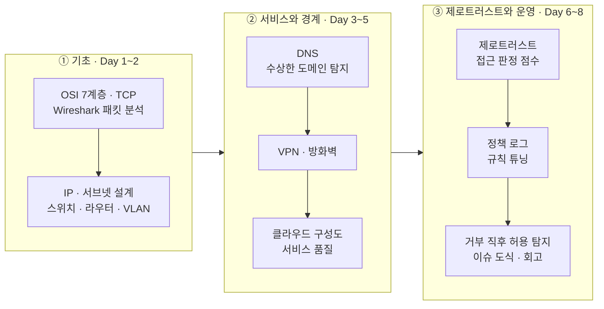

# 🌐 network_zt_2 — 네트워크 · 제로트러스트

SK ALEPH 부트캠프 2과목 (10/12 ~ 10/21). 8일 동안 패킷 분석부터 제로트러스트 정책 로그 판정까지 배운 내용과 실습 코드입니다.

## 배운 순서

## 일차별로 한 것

| 일차 | 한 것 | 주요 파일 |
|---|---|---|
| Day&nbsp;1&nbsp;(10/12) | OSI 7계층과 TCP 연결 과정을 배우고, Wireshark로 패킷을 잡아 분석 보고서를 썼습니다. | `day01_packet_analysis.md` |
| Day&nbsp;2&nbsp;(10/13) | IP 주소와 서브넷 나누는 법, 스위치 · 라우터 · VLAN을 배우고 서브넷 설계서를 썼습니다. | `day02_subnet_design.md` |
| Day&nbsp;3 | DNS가 이름을 IP로 바꾸는 과정을 보고, 수상한 도메인을 점수로 가리는 코드를 짰습니다. 이름이 10글자 이상이면 +1, TLD가 top · xyz · tk면 +1, 없는 도메인(NXDOMAIN)이면 +2를 주고 3점 이상을 의심으로 봅니다. | `day03_pm_dns_suspicious.md` `day03_7-1_judge_new.py` |
| Day&nbsp;4 | VPN 터널 · 암호화와 접속 로그를 보고, 방화벽 규칙의 순서와 허용 목록을 배워 방화벽 규칙서를 썼습니다. | `day04_am_vpn.md` `day04_pm_firewall.md` |
| Day&nbsp;5 | 클라우드 망 구성도를 읽고 그렸고, 지연 · 지터 · 손실과 tracert로 네트워크 품질을 진단했습니다. | `day05_am_cloud_diagram.md` `day05_pm_quality.md` |
| Day&nbsp;6 | A사 제로트러스트 적용 방안을 썼습니다. 직원 12명 데이터로 MFA · 기기 점검 · 최소권한 · 세그멘테이션 · 위험 기반 인증을 항목당 20점씩 매겨 100점 만점 점수를 계산했습니다. 오후에는 Docker 기초를 배웠습니다. | `day06_zt_scenario.md` `day06_4-1_zt_score.py` |
| Day&nbsp;7 | 정책 로그를 읽고, 해외 접속 · 대량 조회 점수 기준을 네 가지로 바꿔 가며 정상 요청을 막는 경우(오탐)와 위험 요청을 놓치는 경우(미탐)를 세어 비교했습니다. 정산 포털 로그 점검 결과를 고객용 보고서로 정리했고, 오후에는 Docker Compose를 배웠습니다. | `day07_4-1_rule_tuning.py` `day07_customer_report.md` |
| Day&nbsp;8&nbsp;(10/21) | 같은 계정이 거부된 뒤 10분 안에 허용된 접속을 찾는 코드를 짰습니다. 이상한 페이지가 열리는 이슈를 증상 → 진단 → 원인 가설 순서로 도식으로 그리고, 2과목 회고를 썼습니다. | `day08_3-1_deny_then_allow.py` `day08_issue_diagram.md` `day08_retrospective.md` |

`warmup_*.py` · `ping_check.py` · `addr_kind.py`는 수업 시작 전 몸풀기 코드입니다.

## 참고

- `*_report.md` 파일(11개, `day07_customer_report.md` 제외)은 교시별 리포트입니다. 질문은 수업에서 주어졌고, `답:` 뒤의 내용은 직접 쓴 것입니다.
- 실습 문서 속 이름 · 주소 · 비밀번호 값은 모두 수업용 예시입니다.

[← 저장소 처음으로](../Readme.md)
