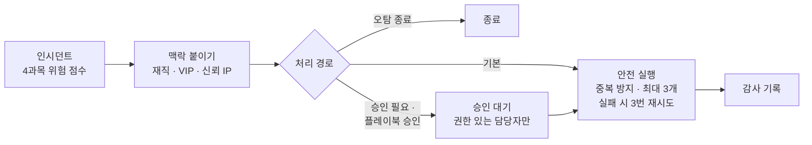

# 🤖 soar_response_5 — 자동 대응(SOAR)

SK ALEPH 부트캠프 5과목 (11/9 ~ , 진행 중). 4과목에서 위험 점수를 매긴 대상을 인시던트로 받아, 계정 정보와 신뢰 IP를 붙여 처리 경로를 정하고, 플레이북에 맞춰 대응을 실행한 뒤 감사 기록을 남깁니다. 정상 사용자에게 영향을 줄 수 있는 조치는 권한 있는 담당자가 승인하기 전까지 실행하지 않고, 같은 조치를 두 번 하거나 한꺼번에 너무 많이 하지 않도록 안전장치를 걸었습니다.

## 흐름



| 실행 | 결과 |
|---|---|
| `day01_6-1_run.py` | 인시던트 5건 중 자동 실행 1건(dami 계정 잠금 · 티켓), 승인 대기 2건, 맞는 플레이북 없음 2건. 감사 기록 4건 |
| `day02_3-1_run.py` | 처리 경로 기본 3 · 승인 필요 1(VIP 계정 gaeun) · 오탐 종료 1(신뢰 IP에서 온 IP 관련 규칙뿐인 jiwoo) |
| `day02_4-1_run.py` | 안전장치 없이 같은 알림을 두 번 처리하면 dami가 두 번 잠기고, 인사 오류 알림 7건이면 7개 계정이 모두 잠김. 안전 실행에서는 이미 잠긴 계정은 건너뛰고 한 번에 3개까지만 잠근 뒤 나머지 4건은 담당자 확인으로 넘김 |
| `day02_5-1_run.py` | 승인 대기 3건 중 실행 1 · 거절 1, 승인 권한이 없는 `intern01`의 승인 1건은 실행하지 않고 기록 |
| `day02_6-1_run.py` | 티켓 서비스가 계속 실패하는 날: 3번 재시도 후 실패로 기록하고, 하루가 끝날 때 담당자 확인 필요 2건을 모아 보여 줌 |

## 플레이북

| 플레이북 | 걸리는 규칙 · 최소 등급 | 조치 | 승인 | 이유 |
|---|---|---|---|---|
| PB&#8209;001 | 퇴사한 계정 · high | 계정 잠금, 티켓 생성 | 자동 | 퇴사한 사람이 쓰는 계정이 없어 잠가도 막히는 업무가 없음 |
| PB&#8209;002 | 대량 다운로드 · mid | 담당자 알림, 티켓 생성 | 담당자 승인 | 업무 때문일 수 있어 사람이 확인하기 전에는 정상인지 알 수 없음 |
| PB&#8209;003 | 경로 스캔 · low | IP 차단, 티켓 생성 | 담당자 승인 | 같은 IP를 여러 사람이 쓸 수 있어 차단하면 정상 사용자도 막힘 |

인시던트 상태는 탐지됨 → 분류됨 → 조치됨 → 보고됨 → 종료 순서로만 바뀌고, 순서를 건너뛰는 변경은 거부합니다. 계정 잠금은 사용자에게만, IP 차단은 IP에만 실행하고 대상이 맞지 않으면 건너뜁니다.

## 일차별로 한 것

| 일차 | 한 것 | 주요 파일 |
|---|---|---|
| Day&nbsp;1&nbsp;(11/9)&nbsp;오후 | SOAR와 플레이북 4요소(조건 · 조치 · 승인 · 이유)를 배우고, 경로 스캔 플레이북 PB-003을 썼습니다. 알림 두 건을 `system_state.json`을 직접 고쳐 수동 처리한 뒤, 플레이북 실행기로 인시던트 5건을 한 번에 처리하고 감사 기록을 남겼습니다. | `incident.py`<br/>`playbook_runner.py`<br/>`config/playbook_registry.json` |
| Day&nbsp;2&nbsp;(11/10)&nbsp;오전 | 알림마다 재직 여부 · VIP · 접속 IP · 신뢰 IP 여부를 붙이고, 이 정보로 처리 경로(기본 · 승인 필요 · 오탐 종료)를 정했습니다. 같은 알림을 두 번 처리하거나 인사 오류로 알림이 몰릴 때 계정이 잘못 잠기는 문제를 재현한 뒤, 중복 잠금 방지와 한 번에 3개 제한을 넣은 안전 실행기를 만들었습니다. | `enrichment.py`<br/>`routing.py`<br/>`safe_runner.py` |
| Day&nbsp;2&nbsp;(11/10)&nbsp;오후 | 승인 대기 건을 모으고, 담당자 결정(승인 · 거절)을 처리하되 승인 권한 목록에 없는 사람의 승인은 실행하지 않게 했습니다. 외부 서비스가 실패하면 3번까지 다시 시도하고, 그래도 실패한 건은 담당자 확인 목록으로 모으는 하루 흐름을 만들었습니다. | `approvals.py`<br/>`retry_runner.py`<br/>`flow.py`<br/>`failure_report.py` |

## 알아 둘 점

- `system_state.json`은 모의 시스템 상태입니다. 실제 계정이나 방화벽을 바꾸지 않습니다.
- Day 1에서는 gaeun · jiwoo가 맞는 플레이북이 없어 탐지됨으로 남았습니다. Day 2에서 맥락을 붙이자 gaeun은 VIP라 승인 필요로, jiwoo는 신뢰 IP라 오탐 종료로 처리 경로가 정해졌습니다.
- 승인 권한은 `approvals.py`의 목록(`kim.sec`, `lee.soc`)으로만 정합니다. 실제 서비스라면 로그인한 사용자의 역할로 확인해야 합니다.

## 실행

```bash
cd soar_response_5
python day01_6-1_run.py   # 플레이북 실행기 → system_state.json, action_log.json
python day02_4-1_run.py   # 안전장치 없는 방식과 안전 실행 비교
python day02_6-1_run.py   # 경로 · 승인 · 재시도까지 하루 흐름
```

## 참고

- 실습 문서와 샘플 데이터는 수업에서 제공받았습니다.
- `*_report.md` 파일(3개)은 교시별 리포트입니다. 질문은 수업에서 주어졌고, `답:` 뒤의 내용은 직접 푼 결과를 AI 도구로 정리해 적었습니다.

[← 저장소 처음으로](../Readme.md)
