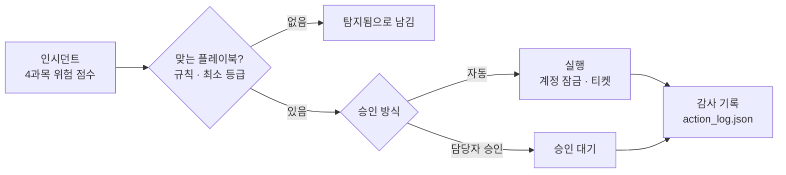

# 🤖 soar_response_5 — 자동 대응(SOAR)

SK ALEPH 부트캠프 5과목 (11/9 ~ , 진행 중). 4과목에서 위험 점수를 매긴 대상을 인시던트로 받아, 미리 등록한 플레이북에 맞춰 대응을 실행하고 감사 기록을 남깁니다. 되돌리기 어렵거나 정상 사용자에게 영향을 줄 수 있는 조치는 담당자 승인 전까지 실행하지 않습니다.

## 흐름



`python day01_6-1_run.py` 결과: 인시던트 5건 중 자동 실행 1건(dami 계정 잠금 · 티켓 1건), 승인 대기 2건, 맞는 플레이북 없음 2건. 감사 기록 4건 저장.

## 플레이북

| 플레이북 | 걸리는 규칙 · 최소 등급 | 조치 | 승인 | 이유 |
|---|---|---|---|---|
| PB&#8209;001 | 퇴사한 계정 · high | 계정 잠금, 티켓 생성 | 자동 | 퇴사한 사람이 쓰는 계정이 없어 잠가도 막히는 업무가 없음 |
| PB&#8209;002 | 대량 다운로드 · mid | 담당자 알림, 티켓 생성 | 담당자 승인 | 업무 때문일 수 있어 사람이 확인하기 전에는 정상인지 알 수 없음 |
| PB&#8209;003 | 경로 스캔 · low | IP 차단, 티켓 생성 | 담당자 승인 | 같은 IP를 여러 사람이 쓸 수 있어 차단하면 정상 사용자도 막힘 |

인시던트 상태는 탐지됨 → 분류됨 → 조치됨 → 보고됨 → 종료 순서로만 바뀌고, 순서를 건너뛰는 변경은 거부합니다. 계정 잠금은 사용자에게만, IP 차단은 IP에만 실행하고 대상이 맞지 않으면 건너뜁니다.

## 일차별로 한 것

| 일차 | 한 것 | 주요 파일 |
|---|---|---|
| Day&nbsp;1&nbsp;(11/9)&nbsp;오후 | SOAR와 플레이북 4요소(조건 · 조치 · 승인 · 이유)를 배우고, 경로 스캔 플레이북 PB-003을 썼습니다. 알림 두 건을 `system_state.json`을 직접 고쳐 수동 처리한 뒤, 플레이북 실행기로 인시던트 5건을 한 번에 처리하고 감사 기록을 남겼습니다. | `incident.py`<br/>`playbook_runner.py`<br/>`config/playbook_registry.json` |

## 알아 둘 점

- `system_state.json`은 모의 시스템 상태입니다. 실제 계정이나 방화벽을 바꾸지 않습니다.
- gaeun · jiwoo 인시던트는 맞는 플레이북이 없어 탐지됨 상태로 남습니다. 사람이 직접 봐야 하는 대상입니다.

## 실행

```bash
cd soar_response_5
python day01_6-1_run.py   # 인시던트 5건 처리 → system_state.json, action_log.json
```

## 참고

- 실습 문서와 샘플 데이터는 수업에서 제공받았습니다.
- `*_report.md` 파일(1개)은 교시별 리포트입니다. 질문은 수업에서 주어졌고, `답:` 뒤의 내용은 직접 푼 결과를 AI 도구로 정리해 적었습니다.

[← 저장소 처음으로](../Readme.md)
