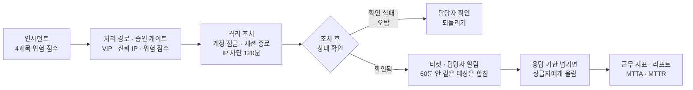

# 🤖 soar_response_5 — 자동 대응(SOAR)

SK ALEPH 부트캠프 5과목 (11/9 ~ , 진행 중). 4과목에서 위험 점수를 매긴 대상을 인시던트로 받아 처리 경로를 정하고, 계정 잠금 · 세션 종료 · IP 차단 같은 격리 조치를 한 뒤 실제로 바뀌었는지 확인합니다. 오탐이면 되돌리고, 조치 결과는 티켓으로 담당자에게 알리며, 응답 기한을 넘긴 티켓은 상급자에게 올리고 근무가 끝나면 지표와 인수인계 목록을 만듭니다. 조치마다 위험 점수를 매겨 자동 · 승인 필요 · 차단 금지로 나누고, 정상 사용자에게 영향을 줄 수 있는 조치는 권한 있는 담당자가 승인하기 전까지 실행하지 않습니다. 근무가 끝나면 처리 결과를 초동 대응 리포트로 정리합니다.

## 흐름


| 실행 | 결과 |
|---|---|
| `day01_6-1_run.py` | 인시던트 5건 중 자동 실행 1건(dami 계정 잠금 · 티켓), 승인 대기 2건, 맞는 플레이북 없음 2건. 감사 기록 4건 |
| `day02_3-1_run.py` | 처리 경로 기본 3 · 승인 필요 1(VIP 계정 gaeun) · 오탐 종료 1(신뢰 IP에서 온 IP 관련 규칙뿐인 jiwoo) |
| `day02_4-1_run.py` | 안전장치 없이 같은 알림을 두 번 처리하면 dami가 두 번 잠기고, 인사 오류 알림 7건이면 7개 계정이 모두 잠김. 안전 실행에서는 이미 잠긴 계정은 건너뛰고 한 번에 3개까지만 잠근 뒤 나머지 4건은 담당자 확인으로 넘김 |
| `day02_5-1_run.py` | 승인 대기 3건 중 실행 1 · 거절 1, 승인 권한이 없는 `intern01`의 승인 1건은 실행하지 않고 기록 |
| `day02_6-1_run.py` | 티켓 서비스가 계속 실패하는 날: 3번 재시도 후 실패로 기록하고, 하루가 끝날 때 담당자 확인 필요 2건을 모아 보여 줌 |
| `day03_3-1_run.py` | IP 차단 요청 3건 중 1건만 차단(120분 뒤 자동 해제). 허용 목록 IP와 여러 계정이 함께 쓰는 IP는 차단하지 않고 담당자에게 넘김 |
| `day03_4-1_run.py` | 잠겼는데 세션이 열려 있는 계정(junho)을 점검으로 찾아내고, 잠금과 세션 종료를 같이 해서 빈틈을 0개로 만듦 |
| `day03_5-1_run.py` | 오탐으로 확인된 3건을 되돌림: 계정 잠금 · IP 차단은 원래대로, 끊은 세션은 되돌릴 수 없다고 기록 |
| `day03_6-1_run.py` | 하루 흐름: 조치 5건 중 변경됨 2 · 변경 없음 2 · 확인 실패 1(방화벽 연결 실패), 담당자 확인 4건 |
| `day04_3-1_run.py` | 알림 11건을 같은 대상 · 60분 기준으로 합쳐 티켓 7장. 해결된 티켓을 다시 열림으로 바꾸는 요청은 거절 |
| `day04_5-1_run.py` | 응답 기한(high 15분 · mid 60분 · low 240분)을 넘긴 티켓 4장을 상급자에게 올림. 30분 이상 넘긴 2장은 한 단계 위(soc.head)로 |
| `day04_6-1_run.py` | 근무 지표: 티켓 7장 중 확인 5 · 해결 3, 평균 확인 시간(MTTA) 55분 · 평균 해결 시간(MTTR) 84분, 기한을 넘겨 확인한 티켓 2장. 해결 안 된 4장은 다음 근무자 인수인계 목록으로 |
| `day05_2-1_run.py` | 티켓 7장과 조치 기록 10건을 대조해 초동 대응 리포트(32줄) 작성. 평균 확인 시간 high 10분 · mid 85분, 기한을 넘겨 확인한 티켓 2장, 티켓 없이 실행된 조치 1건(yuna 계정 잠금)을 찾음 |
| `day05_3-1_run.py` | 조치 요청 8건을 위험 점수(등급 · VIP +3 · 공용 IP +2 · 대상 4개 이상 +2, 3점 이상이면 승인 필요)로 자동 3 · 승인 필요 3 · 차단 금지 2(허용 목록 IP)로 나눔 |
| `day05_4-1_run.py` | 오탐 신고 2건(출장 중 계정 jiwoo · 점검 업체 스캐너 IP)의 조치를 되돌리고 25분 · 5분 만에 복구 확인(기준 30분). 진짜 공격 계정 dami의 잠금은 그대로 둠 |
| `day05_5-1_run.py` | 자동 조치 6개를 영향도 × 발생 가능성으로 평가: 높음 3개(계정 잠금 · 세션 종료 · IP 차단), 빠진 통제 2개(세션 종료의 승인 게이트 · 담당자 알림의 감사 기록) |
| `day05_6-1_run.py` | 마무리 점검 3항목(리포트 누락 · 승인 분류 · 오탐 복구) 모두 통과 |

## 플레이북

| 플레이북 | 걸리는 규칙 · 최소 등급 | 조치 | 승인 | 이유 |
|---|---|---|---|---|
| PB&#8209;001 | 퇴사한 계정 · high | 계정 잠금, 티켓 생성 | 자동 | 퇴사한 사람이 쓰는 계정이 없어 잠가도 막히는 업무가 없음 |
| PB&#8209;002 | 대량 다운로드 · mid | 담당자 알림, 티켓 생성 | 담당자 승인 | 업무 때문일 수 있어 사람이 확인하기 전에는 정상인지 알 수 없음 |
| PB&#8209;003 | 경로 스캔 · low | IP 차단, 티켓 생성 | 담당자 승인 | 같은 IP를 여러 사람이 쓸 수 있어 차단하면 정상 사용자도 막힘 |

인시던트 상태는 탐지됨 → 분류됨 → 조치됨 → 보고됨 → 종료 순서로만 바뀌고, 순서를 건너뛰는 변경은 거부합니다. 계정 잠금은 사용자에게만, IP 차단은 IP에만 실행하고 대상이 맞지 않으면 건너뜁니다.

## 일차별로 한 것

| 일차 | 한 것 | 주요 파일 |
|---|---|---|
| Day&nbsp;1&nbsp;(11/9)&nbsp;오후 | SOAR와 플레이북 4요소(조건 · 조치 · 승인 · 이유)를 배우고, 경로 스캔 플레이북 PB-003을 썼습니다. 알림 두 건을 `system_state.json`을 직접 고쳐 수동 처리한 뒤, 플레이북 실행기로 인시던트 5건을 한 번에 처리하고 감사 기록을 남겼습니다. | `incident.py`<br/>`playbook_runner.py`<br/>`config/playbook_registry.json` |
| Day&nbsp;2&nbsp;(11/10)&nbsp;오전 | 알림마다 재직 여부 · VIP · 접속 IP · 신뢰 IP 여부를 붙이고, 이 정보로 처리 경로(기본 · 승인 필요 · 오탐 종료)를 정했습니다. 같은 알림을 두 번 처리하거나 인사 오류로 알림이 몰릴 때 계정이 잘못 잠기는 문제를 재현한 뒤, 중복 잠금 방지와 한 번에 3개 제한을 넣은 안전 실행기를 만들었습니다. | `enrichment.py`<br/>`routing.py`<br/>`safe_runner.py` |
| Day&nbsp;2&nbsp;(11/10)&nbsp;오후 | 승인 대기 건을 모으고, 담당자 결정(승인 · 거절)을 처리하되 승인 권한 목록에 없는 사람의 승인은 실행하지 않게 했습니다. 외부 서비스가 실패하면 3번까지 다시 시도하고, 그래도 실패한 건은 담당자 확인 목록으로 모으는 하루 흐름을 만들었습니다. | `approvals.py`<br/>`retry_runner.py`<br/>`flow.py`<br/>`failure_report.py` |
| Day&nbsp;3&nbsp;(11/11)&nbsp;오전 | 계정 잠금 · IP 차단 · 세션 종료를 조치 전후 상태를 남기는 방식으로 만들었습니다. IP 차단은 시간을 정해 자동으로 풀리게 하고, 허용 목록 IP와 여러 계정이 함께 쓰는 IP는 차단하지 않게 했습니다. 잠겼는데 세션이 남아 있는 빈틈도 찾아 막았습니다. | `containment.py`<br/>`ip_actions.py`<br/>`session_actions.py`<br/>`containment_store.py` |
| Day&nbsp;3&nbsp;(11/11)&nbsp;오후 | 오탐으로 확인된 조치를 되돌리는 기능을 만들고, 되돌릴 수 없는 조치(세션 종료)는 따로 기록했습니다. 조치 뒤 상태를 다시 읽어 실제로 바뀌었는지 확인하고, 방화벽 연결 실패 같은 확인 실패를 담당자 목록으로 모으는 하루 훈련을 했습니다. | `rollback.py`<br/>`undo_actions.py`<br/>`drill.py`<br/>`shift_report.py` |
| Day&nbsp;4&nbsp;(11/12)&nbsp;오전 | 조치 결과를 등급별 응답 기한이 붙은 티켓으로 만들고, 같은 대상의 알림은 60분 안이면 한 티켓으로 합쳤습니다. 티켓 상태는 열림 → 확인 중 → 해결 순서로만 바꾸고, 담당자 알림은 30분 간격을 두고 실패하면 3번까지 다시 보냅니다. | `ticketing.py`<br/>`ticket_merge.py`<br/>`ticket_notice.py` |
| Day&nbsp;4&nbsp;(11/12)&nbsp;오후 | 응답 기한을 넘긴 열림 티켓을 넘긴 시간에 따라 단계별 상급자에게 올리고, 근무가 끝나면 MTTA · MTTR · 기한 위반 수와 다음 근무자에게 넘길 티켓 목록을 만들었습니다. | `escalation.py`<br/>`shift_metrics.py`<br/>`config/escalation_rules.json` |
| Day&nbsp;5&nbsp;(11/13)&nbsp;오전 | 어제 티켓과 조치 기록을 판다스로 집계 · 대조해 초동 대응 리포트를 만들었습니다. 조치 요청마다 위험 점수를 더해 자동 · 승인 필요 · 차단 금지로 나누는 승인 게이트를 만들고, 기준은 설정 파일로 뺐습니다. 오탐 신고가 오면 영향 확인 → 되돌리기 → 복구 확인 순서로 처리합니다. | `report.py`<br/>`approval_gate.py`<br/>`false_positive.py`<br/>`config/approval_policy.json` |
| Day&nbsp;5&nbsp;(11/13)&nbsp;오후 | 자동 조치 6개의 위험을 점수로 매겨 빠진 통제를 찾은 리스크 평가 문서를 쓰고, 리포트 · 승인 분류 · 오탐 복구를 점검 목록으로 확인했습니다. | `risk_assessment.py`<br/>`risk_assessment.md`<br/>`day4_check.py` |

## 알아 둘 점

- `system_state.json`은 모의 시스템 상태입니다. 실제 계정이나 방화벽을 바꾸지 않습니다.
- Day 1에서는 gaeun · jiwoo가 맞는 플레이북이 없어 탐지됨으로 남았습니다. Day 2에서 맥락을 붙이자 gaeun은 VIP라 승인 필요로, jiwoo는 신뢰 IP라 오탐 종료로 처리 경로가 정해졌습니다.
- 승인 권한은 `approvals.py`의 목록(`kim.sec`, `lee.soc`)으로만 정합니다. 실제 서비스라면 로그인한 사용자의 역할로 확인해야 합니다.
- 세션 종료는 되돌릴 수 없습니다. 오탐이어도 사용자가 다시 로그인해야 해서, 되돌리기 기록에 따로 남깁니다.
- Day 4 담당자 알림과 상급자 올림은 `127.0.0.1:5001`에 알림 서버가 떠 있어야 성공합니다. 서버가 없으면 "알림 실패"로 기록하고 올림 단계도 올라가지 않습니다. 위 결과는 알림 서버를 띄운 상태의 값입니다.
- Day 5 리스크 평가에서 세션 종료는 되돌릴 수 없는데 승인 게이트가 없다는 점이 나왔습니다. 보완 대상으로 적어 두었고, 코드에는 아직 반영하지 않았습니다.

## 실행

```bash
cd soar_response_5
python day01_6-1_run.py   # 플레이북 실행기 → system_state.json, action_log.json
python day02_4-1_run.py   # 안전장치 없는 방식과 안전 실행 비교
python day02_6-1_run.py   # 경로 · 승인 · 재시도까지 하루 흐름
python day03_6-1_run.py   # 격리 조치 · 확인 · 담당자 목록 하루 훈련
python day04_6-1_run.py   # 티켓 · 올림 · 근무 지표 (알림 서버 127.0.0.1:5001 필요)
python day05_3-1_run.py   # 위험 점수로 자동 · 승인 필요 · 차단 금지 나누기
python day05_6-1_run.py   # 리포트 · 승인 분류 · 오탐 복구 점검
```

## 참고

- 교시별 실습 문서(리포트를 뺀 `day*.md`)는 수업에서 받은 자료를 AI 도구로 정리한 것이고, 샘플 데이터는 수업에서 제공받았습니다.
- `*_report.md` 파일(9개)은 교시별 리포트입니다. 질문은 수업에서 주어졌고, `답:` 뒤의 내용은 직접 푼 결과를 AI 도구로 정리해 적었습니다.

[← 저장소 처음으로](../Readme.md)
